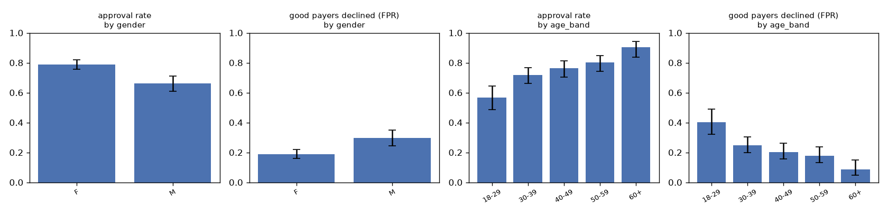

# Fairness analysis (Week 6)

**Team:** Credit Risk Project Team  
**Analysis date:** November 22, 2026  
**Source:** `reports/fairness/fairness.md` and `reports/fairness/fairness.json`

## 1. What we compared, and on which data

We assessed the credit-risk model on the **held-out validation set of 1,000 applicants**, not its training data, to avoid evaluating group-level outcomes on applicants used to fit the model. The two comparisons were **CODE_GENDER** (F and M) and **age bands** (18–29, 30–39, 40–49, 50–59, 60+), with age calculated from `DAYS_BIRTH`. An applicant is **rejected** when the calibrated predicted probability of default is **at least 0.085 (8.5%)**; otherwise, the applicant is approved. The observed target `y=1` indicates default. Both `CODE_GENDER` and `DAYS_BIRTH` are among the model's 20 features, so the model has access to the group attributes directly.

The **true positive rate (TPR)** is the fraction of applicants who actually defaulted that the model rejected. The **false positive rate (FPR)** is the fraction of applicants who did not default that the model rejected. Group rates are descriptive results for this dataset; they do not establish why differences arose.

## 2. The table

### By gender

| Group | Applicants | Defaulters | Approval rate (95% CI) | Actual default rate | Mean predicted score | TPR (95% CI) | FPR (95% CI) |
|---|---:|---:|---|---:|---:|---|---|
| F | 669 | 38 | 78.9% [76%, 82%] | 5.7% | 0.071 | 57.9% [42%, 72%] | 18.9% [16%, 22%] |
| M | 331 | 43 | 66.2% [61%, 71%] | 13.0% | 0.101 | 62.8% [48%, 76%] | 29.5% [25%, 35%] |

### By age band

| Age | Applicants | Defaulters | Approval rate (95% CI) | Actual default rate | Mean predicted score | TPR (95% CI) | FPR (95% CI) |
|---|---:|---:|---|---:|---:|---|---|
| 18–29 | 143 | 16 | 56.6% [48%, 64%] | 11.2% | 0.128 | 68.8% [44%, 86%] | 40.2% [32%, 49%] |
| 30–39 | 282 | 28 | 71.6% [66%, 77%] | 9.9% | 0.091 | 60.7% [42%, 76%] | 24.8% [20%, 30%] |
| 40–49 | 235 | 18 | 76.2% [70%, 81%] | 7.7% | 0.073 | 66.7% [44%, 84%] | 20.3% [15%, 26%] |
| 50–59 | 216 | 13 | 80.1% [74%, 85%] | 6.0% | 0.065 | 53.8% [29%, 77%] | 17.7% [13%, 24%] |
| 60+ | 124 | 6 | 90.3% [84%, 94%] | 4.8% | 0.048 | 33.3% [10%, 70%] | 8.5% [5%, 15%] |

All age-band TPR estimates are flagged by the generated report as **unreliable**, because each band contains fewer than 30 defaulters. The 95% confidence intervals above are Wilson intervals from the assignment's reporting code.

## 3. The gaps

**Gender:** Approval rates differ by **12.76 percentage points** (F higher). Actual default rates also differ (5.7% for F, 13.0% for M), so raw approval gaps should not be interpreted as evidence of unequal treatment at equal risk. Still, the **FPR is 10.65 percentage points higher for M**, meaning a larger share of observed non-defaulters in the M group were rejected. TPR differs by **4.9 percentage points**. The F group has a mean predicted score of 7.1% versus an observed default rate of 5.7%; the M group has a mean score of 10.1% versus 13.0% observed. These aggregate differences warrant a more detailed group calibration assessment.

**Age:** Approval is lowest for **18–29 (56.6%)** and highest for **60+ (90.3%)**, a **33.68-percentage-point** gap. Observed default rates decrease across these groups (11.2% vs 4.8%), but the difference in **FPR** is also large (**40.2% vs 8.5%**, a **31.68-percentage-point** gap). Thus differences in group base rates alone do not fully describe the disparity in mistaken declines. Average predicted risk falls from 12.8% in the youngest group to 4.8% in the oldest. Mean predicted score is a coarse calibration check, not proof of within-group calibration; reliability curves or calibration bins would provide a better test.

## 4. How sure are we?

The gender approval-rate intervals do **not** overlap (F: 76–82%, M: 61–71%). Their FPR intervals also do not overlap (F: 16–22%, M: 25–35%), supporting meaningful descriptive differences in this validation sample. The gender TPR intervals overlap substantially (F: 42–72%, M: 48–76%), so the observed TPR difference is uncertain.

The youngest and oldest age bands have non-overlapping approval intervals (48–64% vs 84–94%) and FPR intervals (32–49% vs 5–15%). However, TPR estimates for **every** age band depend on fewer than 30 defaulters, and the oldest group has only **6**. Their TPR intervals are particularly broad (for 60+: 10–70%). More representative validation observations—especially **default outcomes in each age band**—are needed before making reliable statements about detection-rate parity. The exact additional sample size depends on the gap to detect and desired statistical power; no fixed number can be justified from this run alone. Non-overlapping intervals are a useful warning signal, not a substitute for a formal disparity or causality analysis.

## 5. Proxies

A separate model predicting **M versus F** using the other **19 features** reached **validation AUC 0.742**, versus 0.5 for chance-level ranking. Strongest single-feature proxies reported were `CREDIT_INCOME_RATIO` (0.599), `DAYS_BIRTH` (0.593), `EXT_SOURCE_1` (0.585), `DAYS_EMPLOYED` (0.566), and `POS_COMPLETED_SHARE` (0.561). These features may correlate with gender through underlying differences in employment, credit histories, demographics, or how data was collected.

Simply deleting `CODE_GENDER` would **not necessarily remove gender-related information**, because other features can still predict the attribute. Likewise, deleting `DAYS_BIRTH` would not guarantee that other features do not proxy for age. Removal must be followed by retraining and reevaluating group-level performance and lawful feature use.

## 6. What we recommend

**Do not deploy this model as a fully automated, unreviewed lending decision-maker.** Keep it as a prototype or decision-support system with documented human review. The elevated FPR for M and for younger applicants warrants investigation, including checking feature validity, comparable-risk strata, subgroup calibration, and potential data-quality or sampling effects. Add monitoring for **approval-rate and false-positive-rate gaps**, reported together with counts and confidence intervals; FPR can only be measured after reliable repayment outcomes arrive. Establish alert thresholds and remediation owners with risk/compliance stakeholders rather than inventing a numeric threshold from this small sample.

Before any real lending use, obtain a formal legal and compliance review of use of **gender, age, and their proxies**, applicable fair-lending and adverse-action requirements, and whether explanations are legally adequate. Preserve contestability (human review/appeal), audit trails, and documented procedures for investigating disparities. This analysis alone cannot establish either fairness or unfairness.
